# My GitHub Profile ##

I am currently in my second year of vocational training.

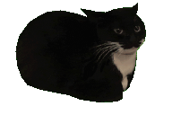

I created this account to learn more about programming.

As of now i am learning Python, HTML, CSS & JavaScript.

---

## About Me ##

- I really like cats
- I really enjoy learning about coding, Git and GitHub

---

  
now time for some cats!

  
  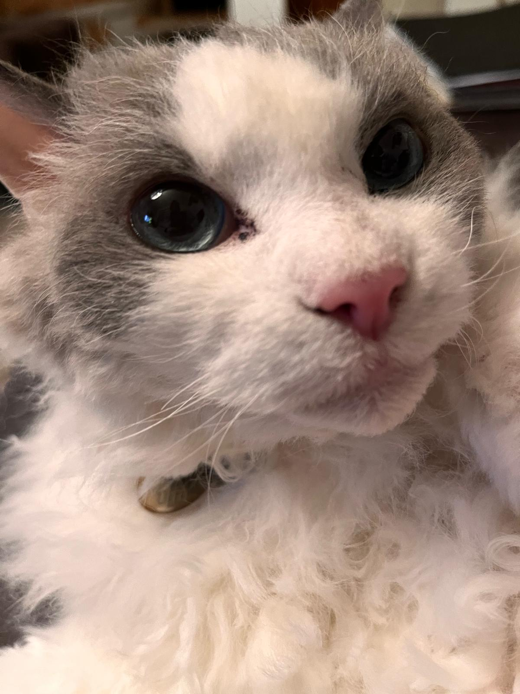
  
  

    
how about some more

  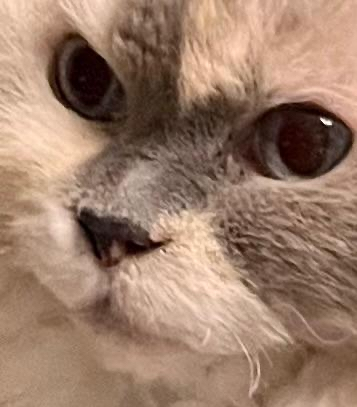
  
  

    
and more

  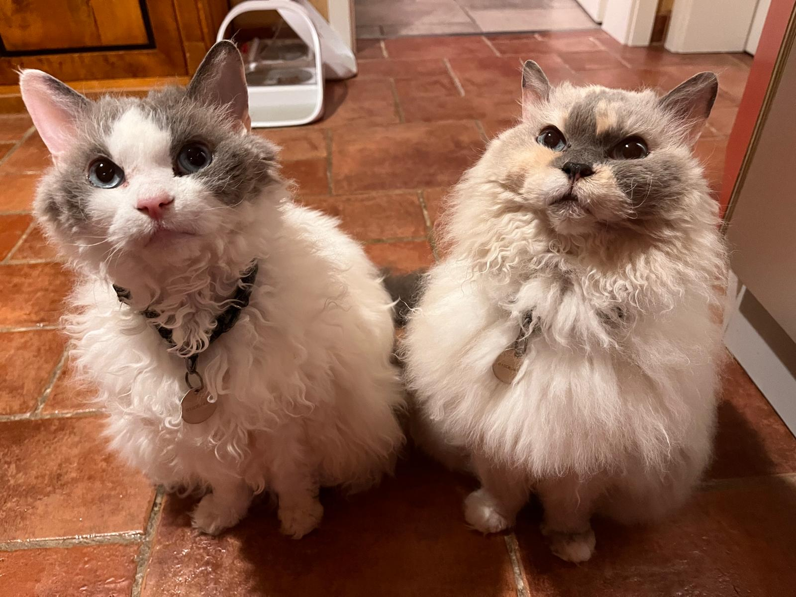

  

    
and even more

  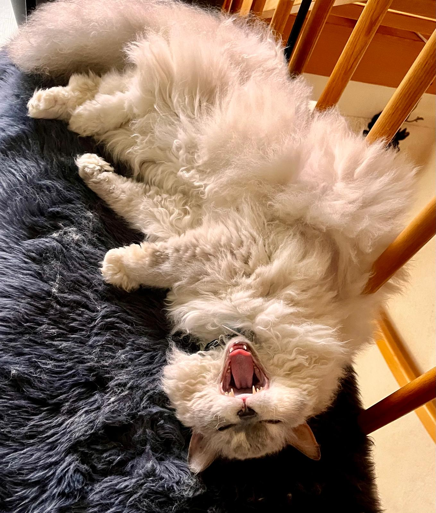

  

    
have some more cats

  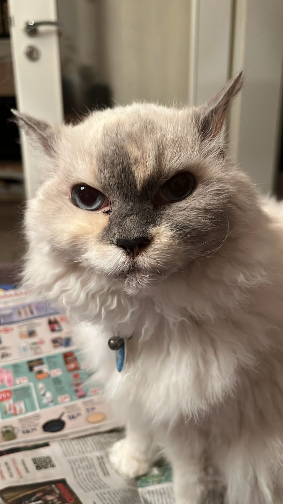
  
  

    
another one

  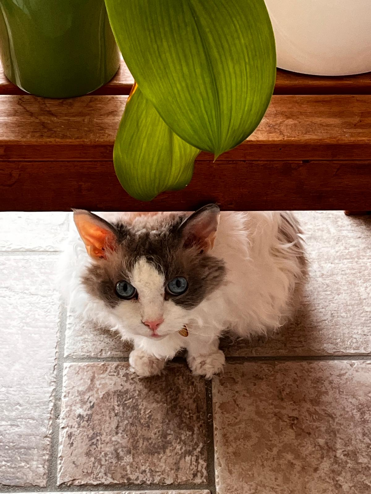

  

    
and another one

  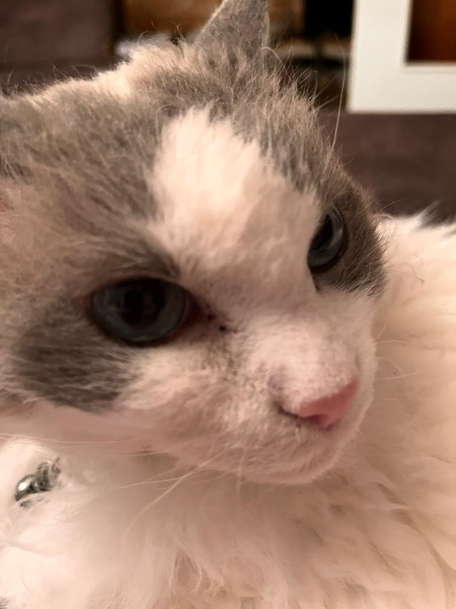

  

    
and another one

  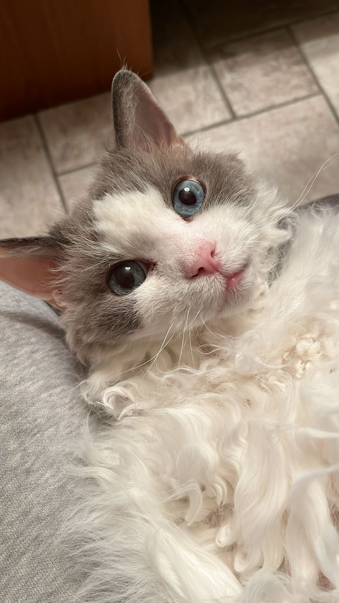

  

    
More!

  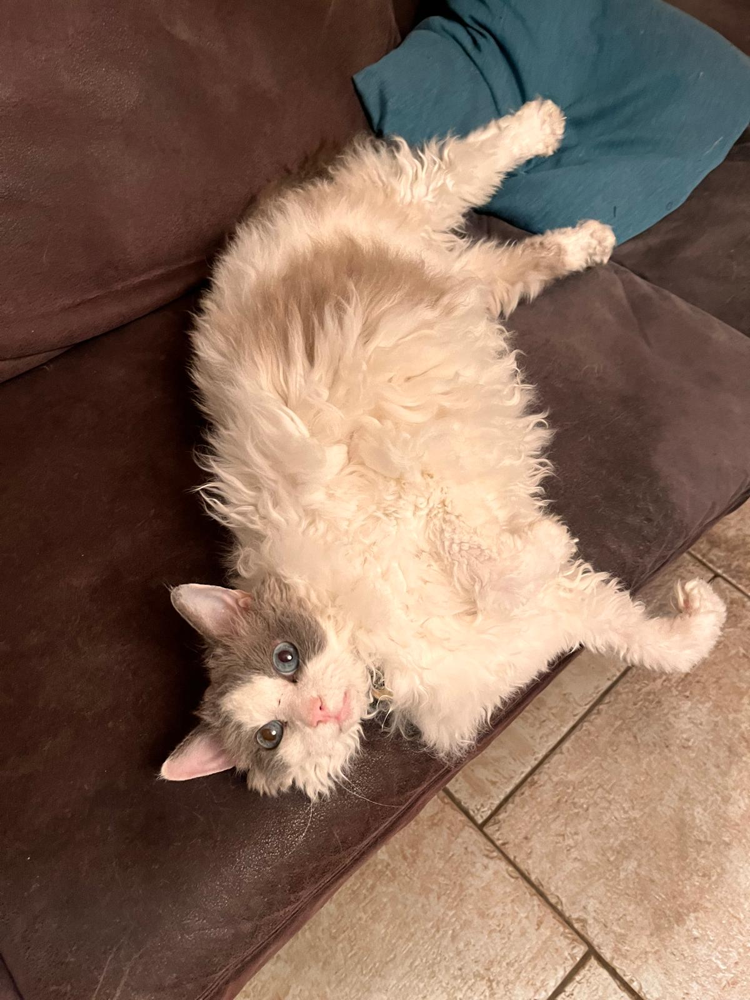

  

    
MORE!

  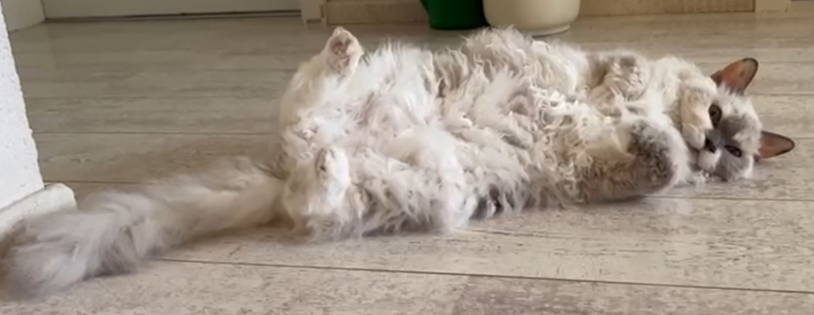

  

    
MOOOOOOOOOOOOORE!!!

  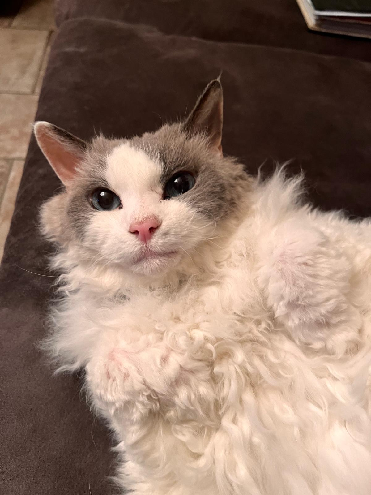

  

    
UUH???

  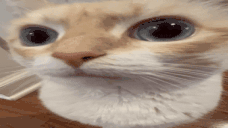

  

  

  

  

  

  

  

  

  

  

  

